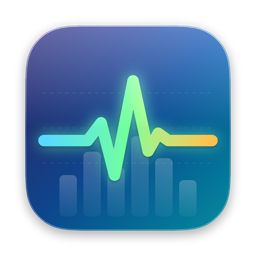
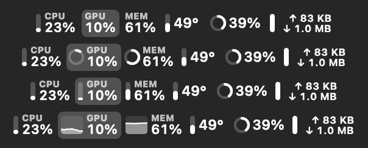
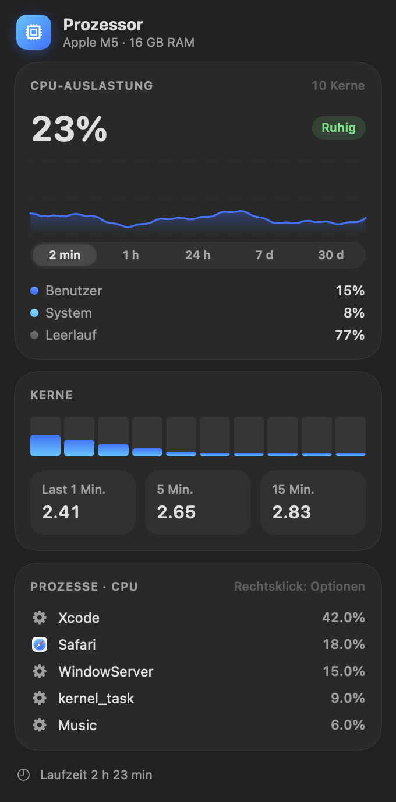
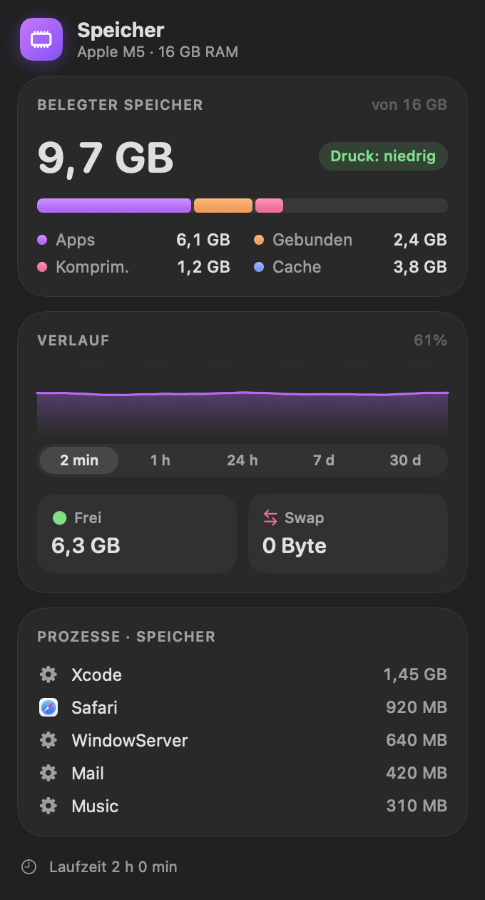
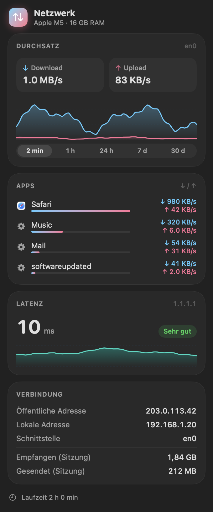
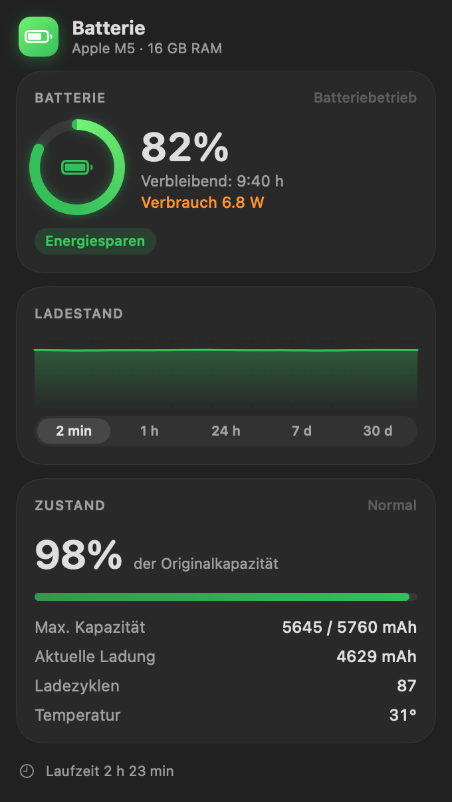
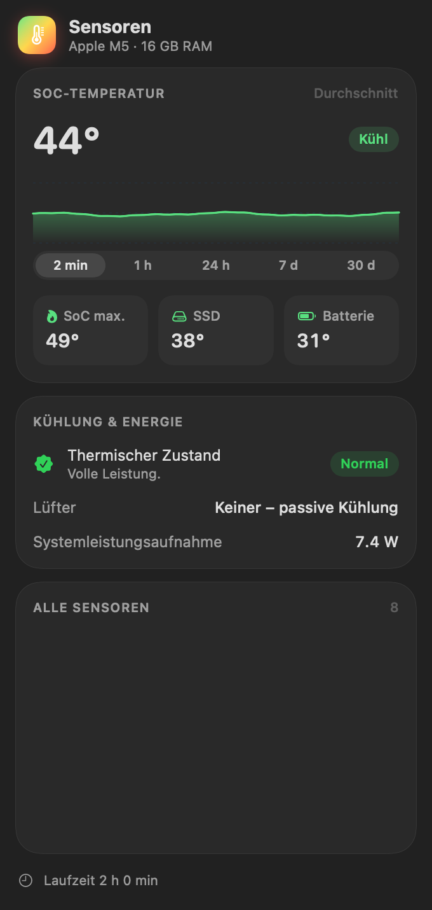
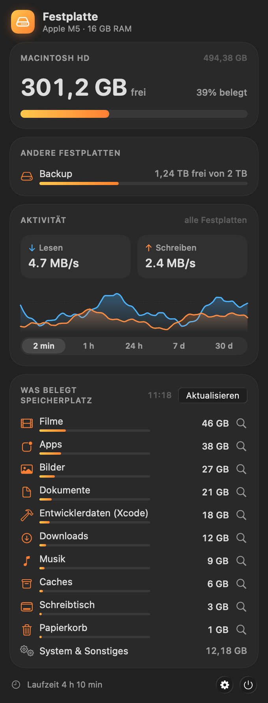

<p align="center">
  
</p>

<h1 align="center">Pulse</h1>

<p align="center">
  Ein schlanker Systemmonitor für die macOS-Menüleiste im Liquid-Glass-Stil.<br>
  CPU · GPU · Speicher · Festplatte · Netzwerk · Temperaturen · Batterie
</p>

<p align="center">
  <a href="https://github.com/kakaki/pulse/releases/latest"><b>⬇︎ Neueste Version laden</b></a> ·
  macOS 15+ · Apple Silicon & Intel · Deutsch / English / Polski
</p>

<p align="center"><a href="README.md">English</a> · <a href="README.pl.md">Polski</a> · <b>Deutsch</b></p>

---

<p align="center">
  
</p>

## Funktionen

- **Übersicht in einem einzigen Menüleistenobjekt.** Alle Module können nebeneinander stehen, oder jedes bekommt ein eigenes Objekt. Ein Klick auf einen Wert in der Menüleiste öffnet die Details dieses Moduls.
- **Vier Darstellungsstile:** Text, Ring, Balken oder Mini-Diagramm. Stil, Beschriftung und Reihenfolge lassen sich für jeden Wert einzeln festlegen; die Reihenfolge änderst du per Drag & Drop.
- **Detaillierte Fenster** für jedes Modul:
  - **CPU:** Auslastung, Kerne, Durchschnittslast, Prozesse mit der höchsten Last, Docker-Container
  - **GPU:** Auslastungsverlauf, Last von Renderer und Tiler, GPU-Speicher, Kerne, Neustarts, Prozesse mit GPU-Nutzung
  - **Speicher:** Speicherdruck, App-, gebundener und komprimierter Speicher, Swap, Prozesse
  - **Festplatte:** belegter oder freier Speicher in Prozent oder GB/TB, mehrere Laufwerke, Lese- und Schreibrate, was den Platz belegt
  - **Netzwerk:** Upload und Download, Datenverkehr pro App, Latenz, lokale und öffentliche IP
  - **Sensoren:** Temperaturen von SoC, SSD und Batterie, Lüfter, thermischer Zustand
  - **Batterie:** Ladeverlauf, Zustand, Ladezyklen, Leistungsaufnahme, Netzteilleistung, Akkus von Bluetooth-Geräten (AirPods, Tastatur, Maus)
  - **Andere Computer:** Auslastung, Temperaturen, Lüfter, Prozesse und Docker-Container anderer Macs mit Pulse und Windows-PCs mit PulseWin im lokalen Netzwerk; Pulse auf diesen Macs aus der Ferne aktualisieren (wenn der Mac es erlaubt)
- **Ladelimit** bei MacBooks (50–95 %), damit der Akku nicht ständig bei 100 % steht.
- **Verlauf über 2 Min., 1 h, 24 h, 7 Tage und 30 Tage**, mit CSV-Export.
- **Praktische Aktionen:** Speicher freigeben (`purge`, fragt nach dem Administratorpasswort), Prozesse per Rechtsklick beenden, IP-Adresse per Klick kopieren.
- **Mitteilungen** bei anhaltender CPU-Last, hoher Temperatur, thermischer Drosselung, Speicherdruck, wenig Speicherplatz und niedrigem Akkustand.
- **Kritische Werte blinken** in der Menüleiste, und bei hoher Last werden Werte eingefärbt.
- **Stört nicht:** blendet sich im Vollbild und bei Bildschirmspiegelung aus und aktualisiert im Batteriebetrieb und im Stromsparmodus seltener.
- **Passt neben die Kamera-Aussparung:** Wenn macOS Pulse aus Platzmangel ausblendet, entfallen Beschriftungen und der schmalste Stil wird gewählt. Auf Wunsch bleibt nur das Pulse-Symbol in der Menüleiste.
- **Widget** für den Schreibtisch und Start beim Anmelden.
- **Automatische Updates** über Sparkle. Jede Version ist von Apple signiert und notarisiert.

## Bildschirmfotos

<table>
  <tr>
    <td align="center" valign="top" width="33%"><b>CPU</b><br></td>
    <td align="center" valign="top" width="33%"><b>Speicher</b><br></td>
    <td align="center" valign="top" width="33%"><b>Netzwerk</b><br></td>
  </tr>
  <tr>
    <td align="center" valign="top" width="33%"><b>Batterie</b><br></td>
    <td align="center" valign="top" width="33%"><b>Sensoren</b><br></td>
    <td align="center" valign="top" width="33%"><b>Festplatte</b><br></td>
  </tr>
</table>

<sub>Die Bildschirmfotos zeigen Demodaten.</sub>

## Installation

1. Lade `Pulse-x.y.dmg` unter [Releases](https://github.com/kakaki/pulse/releases/latest).
2. Öffne das DMG und ziehe **Pulse** in **Programme**.
3. Starte Pulse. Es erscheint in der Menüleiste, ohne Symbol im Dock. Die **Einstellungen** öffnest du aus jedem Fenster.

Pulse sucht automatisch nach Updates. Du kannst auch manuell unter Einstellungen → Allgemein → Updates prüfen.

## Selbst bauen

Benötigt wird Xcode 26 (die Befehlszeilenwerkzeuge reichen, es gibt kein Xcode-Projekt).

```bash
./build.sh --install     # bauen und nach /Applications kopieren (Ad-hoc-Signatur)
./release.sh             # Developer-ID-Signatur, Notarisierung, DMG und Appcast in updates/
```

Übersetzungen liegen in `Localization/Localizable.xcstrings`. Ausgangssprache ist Polnisch. `build.sh` übernimmt bei jedem Build neue Texte in den Katalog.

## Datenschutz

Pulse liest alle Daten lokal aus macOS (IOKit, `host_statistics`, `nettop`, SMC). Die einzigen Netzwerkverbindungen sind eine TCP-Latenzmessung zu `1.1.1.1`, die Abfrage der öffentlichen IP (`api.ipify.org`) und die Update-Prüfung von Sparkle.
