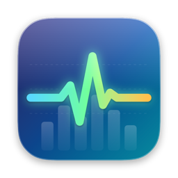
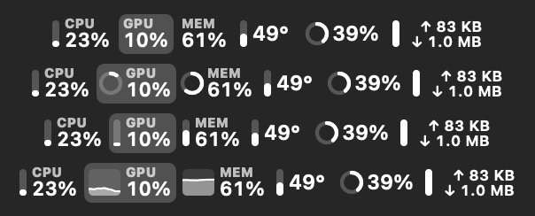
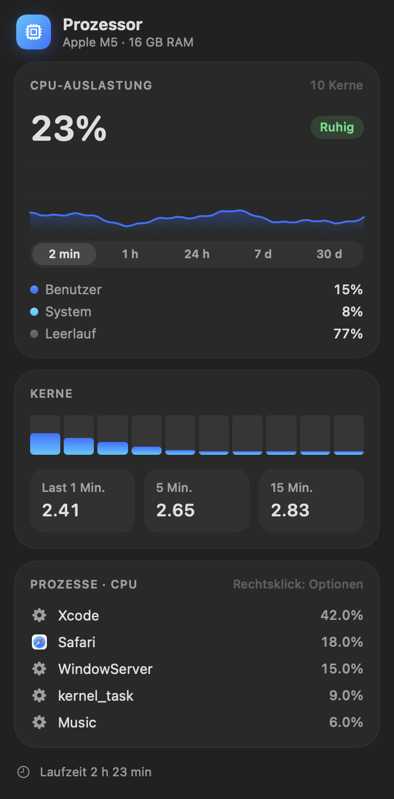
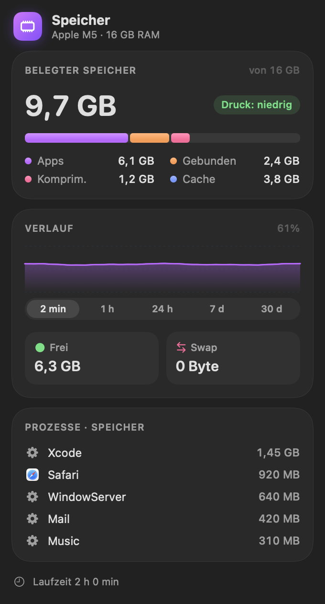
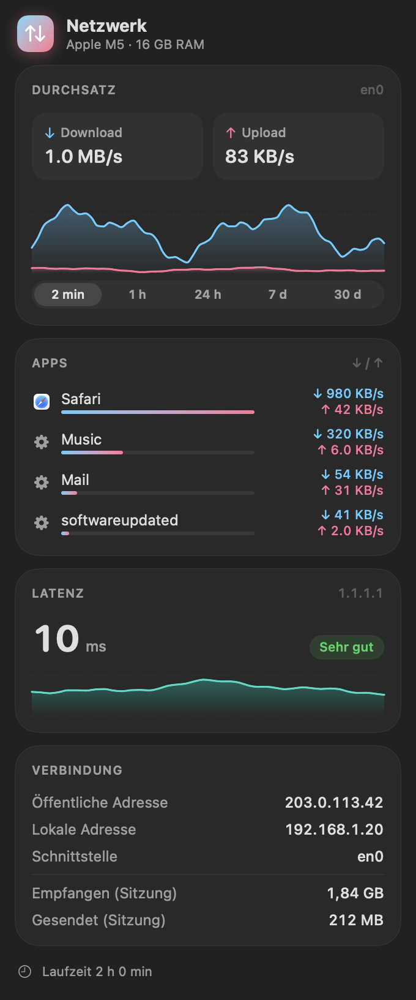
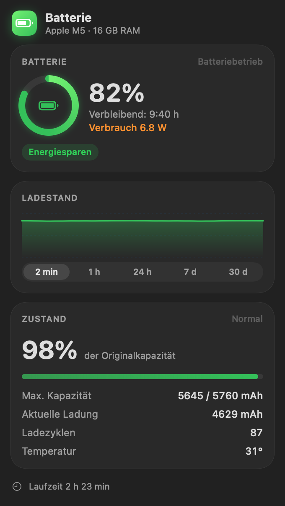
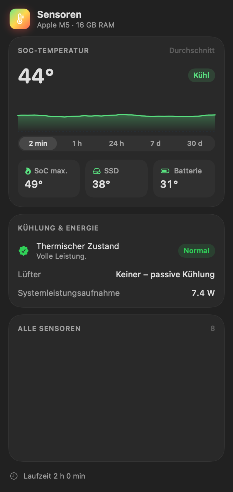
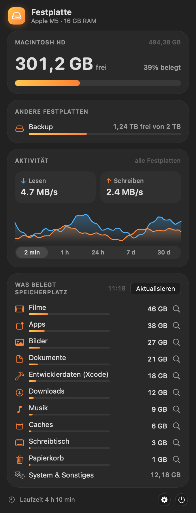

<p align="center">
  
</p>

<h1 align="center">Pulse</h1>

<p align="center">
  Ein schlanker Systemmonitor für die macOS-Menüleiste im Liquid-Glass-Stil.<br>
  CPU · GPU · Speicher · Festplatte · Netzwerk · Temperaturen · Batterie
</p>

<p align="center">
  <a href="https://github.com/kakaki/pulse/releases/latest"><b>⬇︎ Neueste Version laden</b></a> ·
  macOS 15+ · Apple Silicon & Intel · Deutsch / English / Polski
</p>

<p align="center"><a href="README.md">English</a> · <a href="README.pl.md">Polski</a> · <b>Deutsch</b></p>

---

<p align="center">
  
</p>

## Funktionen

- **Übersicht in einem einzigen Menüleistenobjekt.** Alle Module können nebeneinander stehen, oder jedes bekommt ein eigenes Objekt. Ein Klick auf einen Wert in der Menüleiste öffnet die Details dieses Moduls.
- **Vier Darstellungsstile:** Text, Ring, Balken oder Mini-Diagramm. Stil, Beschriftung und Reihenfolge lassen sich für jeden Wert einzeln festlegen; die Reihenfolge änderst du per Drag & Drop.
- **Detaillierte Fenster** für jedes Modul:
  - **CPU:** Auslastung, Kerne, Durchschnittslast, Prozesse mit der höchsten Last, Wochenrhythmus (Lastkarte nach Tag und Stunde), Docker-Container (starten, stoppen, neu starten), Hintergrundprogramme (LaunchAgents) mit CPU- und Speichernutzung, abschaltbar
  - **GPU:** Auslastungsverlauf, Last von Renderer und Tiler, GPU-Speicher, Kerne, Neustarts, Prozesse mit GPU-Nutzung
  - **Speicher:** Speicherdruck, App-, gebundener und komprimierter Speicher, Swap, Prozesse
  - **Festplatte:** belegter oder freier Speicher in Prozent oder GB/TB, mehrere Laufwerke, Lese- und Schreibrate, was den Platz belegt, Prognose, wann das Volume voll ist, SSD-Lebensdauer aus SMART (Abnutzung, geschriebene Daten, Temperatur)
  - **Netzwerk:** Upload und Download in MB/s oder Mb/s, Datenverkehr pro App, Latenz, Verbindungstest (Router oder Internet), lokale und öffentliche IP, WLAN-Details (Signal/Rauschen, Standard, Kanal, Signalverlauf), Datenvolumen pro Monat mit Limit (auch separat über Hotspot)
  - **Sensoren:** Temperaturen von SoC, SSD und Batterie, Lüfter, thermischer Zustand
  - **Batterie:** Ladeverlauf, Zustand, Ladezyklen, Leistungsaufnahme, Netzteilleistung, Energieverbrauch pro App und 24-Std.-Energierangliste (wie viel Akku jede App verbraucht hat), geladene Energie pro Monat, Zustand im Zeitverlauf, Akkus von Bluetooth-Geräten (AirPods, Tastatur, Maus) mit Verlauf; auf Macs ohne Akku (z. B. Mac mini) das Modul **Energie**: Leistungsaufnahme des ganzen Computers mit Verlauf und Tagesverbrauch
  - **Andere Computer:** Auslastung, Temperaturen, Lüfter, Prozesse, Docker-Container und CPU- und Temperaturverlauf anderer Macs mit Pulse und Windows-PCs mit PulseWin im lokalen Netzwerk; Pulse auf diesen Macs aus der Ferne aktualisieren (wenn der Mac es erlaubt)
- **Zwischenablage und Dateien zwischen Computern** (optional, standardmäßig aus): Kopierter Text oder Bilder bleiben auf ihrem Computer, ein anderer Mac mit Pulse oder PC mit PulseWin ruft sie nur auf Anfrage mit ⌃⌥⌘V ab. Dateien und Ordner sendest du, indem du sie auf die Karte des Computers oder auf das Pulse-Symbol in der Menüleiste ziehst. Funktioniert nur zwischen gekoppelten Computern (ein Code wird auf beiden Bildschirmen bestätigt); die Verbindung ist verschlüsselt.
- **Ladelimit** bei MacBooks (50–95 %), damit der Akku nicht ständig bei 100 % steht, mit einmaligem „Voll laden“ vor Reisen. Ab macOS 27 erlaubt Apple nur noch das Ladelimit des Systems; Pulse führt zu dessen Einstellungen.
- **Verlauf über 2 Min., 1 h, 24 h, 7 Tage und 30 Tage**, 7, 14 oder 30 Tage aufbewahrt, mit CSV-Export.
- **Praktische Aktionen:** Speicher freigeben (`purge`, fragt nach dem Administratorpasswort), Prozesse per Rechtsklick beenden (Prozesse mit gleichem Namen lassen sich zusammenfassen), IP-Adresse per Klick kopieren.
- **Mitteilungen** bei anhaltender CPU-Last, hoher Temperatur, thermischer Drosselung, Speicherdruck, wenig Speicherplatz, bald vollem Volume, Datenlimit und niedrigem Akkustand sowie wenn ein Computer im Netzwerk nicht mehr antwortet. Mitteilungen für einen gewählten Prozess (z. B. „Chrome Helper über 80 % für 5 Minuten“) haben eine Beenden-Taste. Montags kommt eine Wochenübersicht.
- **Kurzbefehle bei Schwellen:** z. B. führt eine Temperatur über 90° einen Kurzbefehl deiner Wahl aus.
- **Kritische Werte blinken** in der Menüleiste, und bei hoher Last werden Werte eingefärbt (Schwellen für CPU, Temperatur und Festplatte einstellbar).
- **Wach bleiben:** Der Mac (und optional der Bildschirm) schläft 30 Min., 1 h, 3 h oder bis zum Ausschalten nicht ein.
- **Präsentationsmodus:** Mit einem Klick bleibt nur das Pulse-Symbol, Mitteilungen verstummen; schaltet sich auf Wunsch bei Bildschirmspiegelung selbst ein.
- **Stört nicht:** blendet sich im Vollbild und bei Bildschirmspiegelung aus und aktualisiert im Batteriebetrieb und im Stromsparmodus seltener.
- **Passt neben die Kamera-Aussparung:** Wenn macOS Pulse aus Platzmangel ausblendet, entfallen Beschriftungen und der schmalste Stil wird gewählt. Auf Wunsch bleibt nur das Pulse-Symbol in der Menüleiste.
- **Widgets** für den Schreibtisch (Auslastung oder geladene Energie und wärmster Computer), **Kurzbefehle-Aktionen** zum Abfragen von Werten Start beim Anmelden sowie Export und Import der Einstellungen.
- **Automatische Updates** über Sparkle. Jede Version ist von Apple signiert und notarisiert.

## Bildschirmfotos

<table>
  <tr>
    <td align="center" valign="top" width="33%"><b>CPU</b><br></td>
    <td align="center" valign="top" width="33%"><b>Speicher</b><br></td>
    <td align="center" valign="top" width="33%"><b>Netzwerk</b><br></td>
  </tr>
  <tr>
    <td align="center" valign="top" width="33%"><b>Batterie</b><br></td>
    <td align="center" valign="top" width="33%"><b>Sensoren</b><br></td>
    <td align="center" valign="top" width="33%"><b>Festplatte</b><br></td>
  </tr>
</table>

<sub>Die Bildschirmfotos zeigen Demodaten.</sub>

## Installation

1. Lade `Pulse-x.y.dmg` unter [Releases](https://github.com/kakaki/pulse/releases/latest).
2. Öffne das DMG und ziehe **Pulse** in **Programme**.
3. Starte Pulse. Es erscheint in der Menüleiste, ohne Symbol im Dock. Die **Einstellungen** öffnest du aus jedem Fenster.

Pulse sucht automatisch nach Updates. Du kannst auch manuell unter Einstellungen → Allgemein → Updates prüfen.

## Selbst bauen

Benötigt wird Xcode 26 (es gibt kein Xcode-Projekt; der Build nutzt die App-Intents-Werkzeuge).

```bash
./build.sh --install     # bauen und nach /Applications kopieren (Ad-hoc-Signatur)
./release.sh             # Developer-ID-Signatur, Notarisierung, DMG und Appcast in updates/
```

Übersetzungen liegen in `Localization/Localizable.xcstrings`. Ausgangssprache ist Polnisch. `build.sh` übernimmt bei jedem Build neue Texte in den Katalog.

## Datenschutz

Pulse liest alle Daten lokal aus macOS (IOKit, `host_statistics`, `nettop`, SMC). Die einzigen Netzwerkverbindungen sind eine TCP-Latenzmessung zu `1.1.1.1`, die Abfrage der öffentlichen IP (`api.ipify.org`) und die Update-Prüfung von Sparkle. Messwerte anderer Computer, Zwischenablage und Dateien gehen nur durchs lokale Netzwerk, direkt zwischen den Computern; Zwischenablage und Dateien nur zwischen gekoppelten Computern und verschlüsselt.
