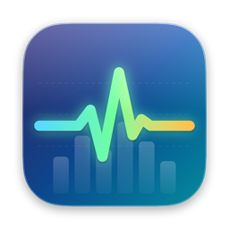
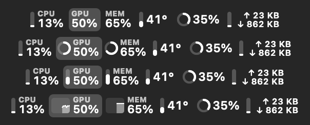
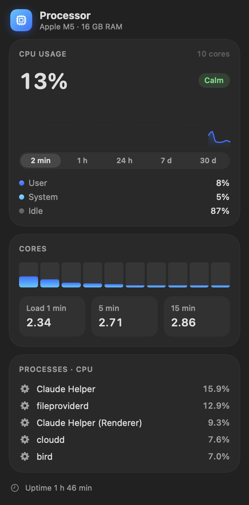
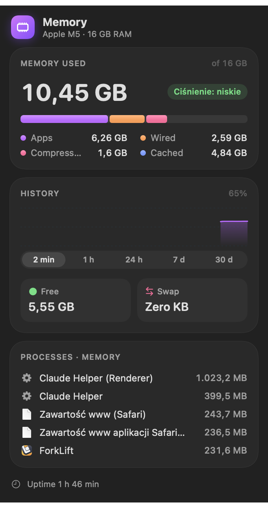
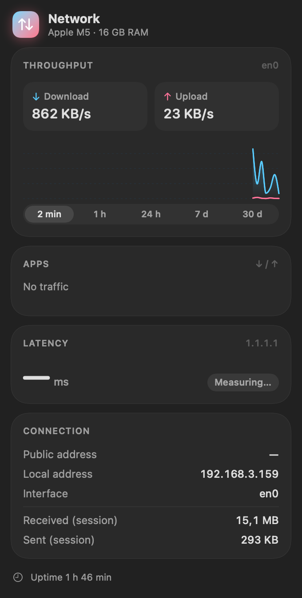
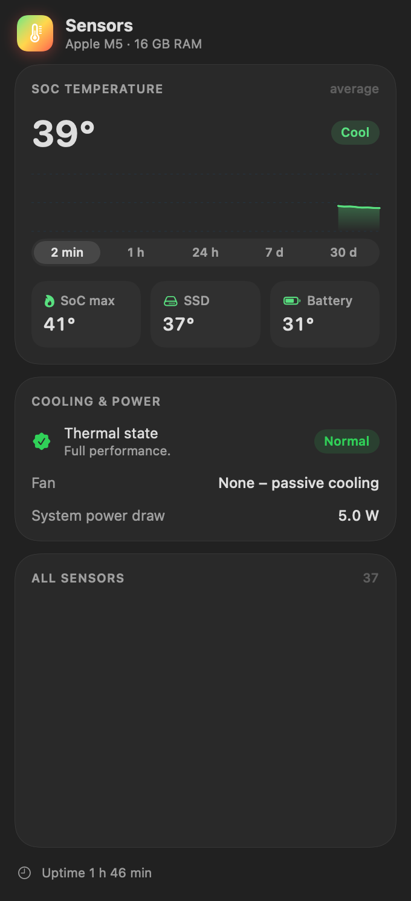
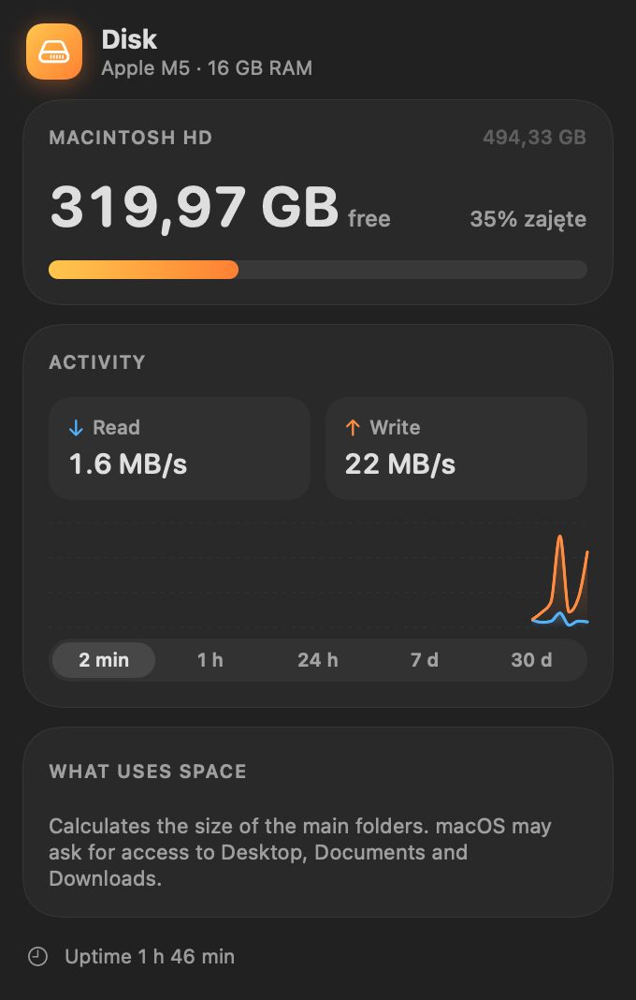
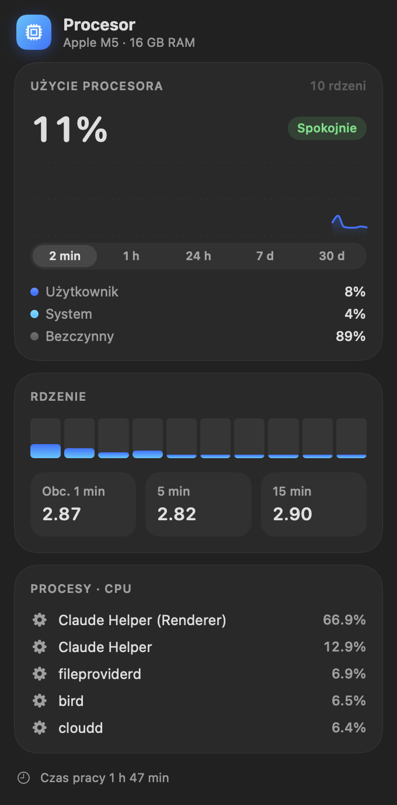
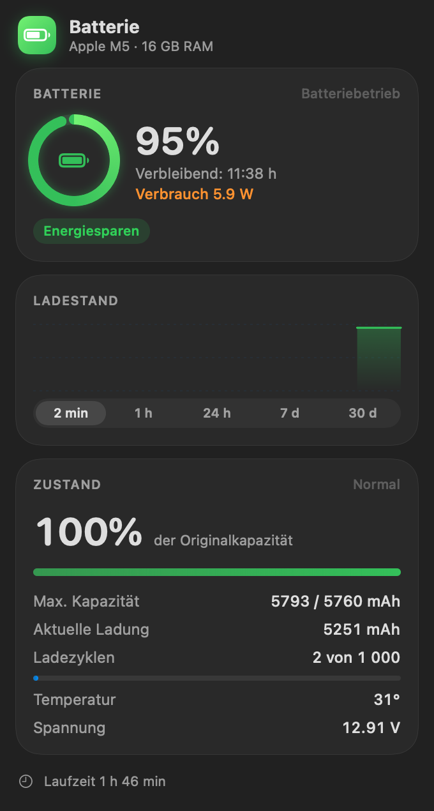

<p align="center">
  
</p>

<h1 align="center">Pulse</h1>

<p align="center">
  A lightweight system monitor for the macOS menu bar, styled with Liquid Glass.<br>
  CPU · GPU · memory · disk · network · temperatures · battery
</p>

<p align="center">
  <a href="https://github.com/kakaki/pulse/releases/latest"><b>⬇︎ Download the latest release</b></a> ·
  macOS 26 · Apple Silicon · English / Deutsch / Polski
</p>

<p align="center"><b>English</b> · <a href="README.pl.md">Polski</a></p>

---

<p align="center">
  
</p>

## Features

- **Overview in a single menu bar item.** Show every module side by side, or give each one its own item. Click a value in the menu bar to open that module's details.
- **Four value styles:** text, ring, bars or a mini graph. You can set the style, label and order separately for each value, and drag to reorder.
- **Detailed panels** for every module:
  - **CPU:** usage, per-core load, load average, top processes
  - **GPU:** usage history
  - **Memory:** pressure, app / wired / compressed memory, swap, top processes
  - **Disk:** free space, read/write speed, and what takes up the space
  - **Network:** upload/download, traffic per app, latency, local and public IP
  - **Sensors:** SoC, SSD and battery temperatures, fans, thermal state
  - **Battery:** charge chart, health, cycle count, power draw, adapter wattage
- **History of 2 min, 1 h, 24 h, 7 d and 30 d**, with CSV export.
- **Notifications** for sustained CPU load, high temperature, thermal throttling, memory pressure, low disk space and low battery.
- **Critical values pulse** in the menu bar, and values are colored under high load.
- **Stays out of the way:** hides in full screen apps and while mirroring a display, and refreshes less often on battery and in Low Power Mode.
- **A desktop widget** and launch at login.
- **Automatic updates** through Sparkle. Every release is signed and notarized by Apple.

## Screenshots

| CPU | Memory | Network |
|:---:|:---:|:---:|
|  |  |  |

| Battery | Sensors | Disk |
|:---:|:---:|:---:|
|  |  |  |

<details>
<summary>Polish and German</summary>

| Polski | Deutsch |
|:---:|:---:|
|  |  |

</details>

## Installation

1. Download `Pulse-x.y.dmg` from [Releases](https://github.com/kakaki/pulse/releases/latest).
2. Open the DMG and drag **Pulse** into **Applications**.
3. Launch Pulse. It appears in the menu bar and has no Dock icon. Open **Settings** from any panel.

Pulse looks for updates automatically. You can also check by hand in Settings → General → Updates.

## Building from source

You need Xcode 26 (the command line tools are enough, no Xcode project involved).

```bash
./build.sh --install     # build and copy to /Applications (ad-hoc signed)
./release.sh             # Developer ID signing, notarization, DMG and appcast in updates/
```

To release a new version, bump `CFBundleShortVersionString` and `CFBundleVersion` in `Info.plist`, run `./release.sh`, then commit and push `updates/`.

Translations live in `Localization/Localizable.xcstrings`. Polish is the source language. `build.sh` syncs new strings into the catalog on every build.

## Privacy

Pulse reads all data locally from macOS (IOKit, `host_statistics`, `nettop`, SMC). The only network requests it makes are a TCP latency check to `1.1.1.1`, a public IP lookup (`api.ipify.org`) and the Sparkle update check.
