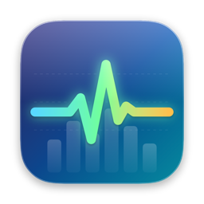
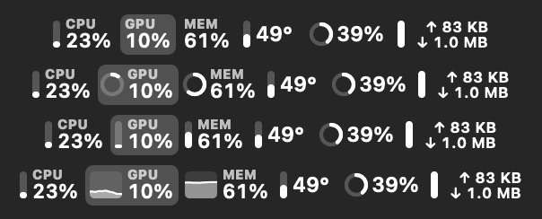
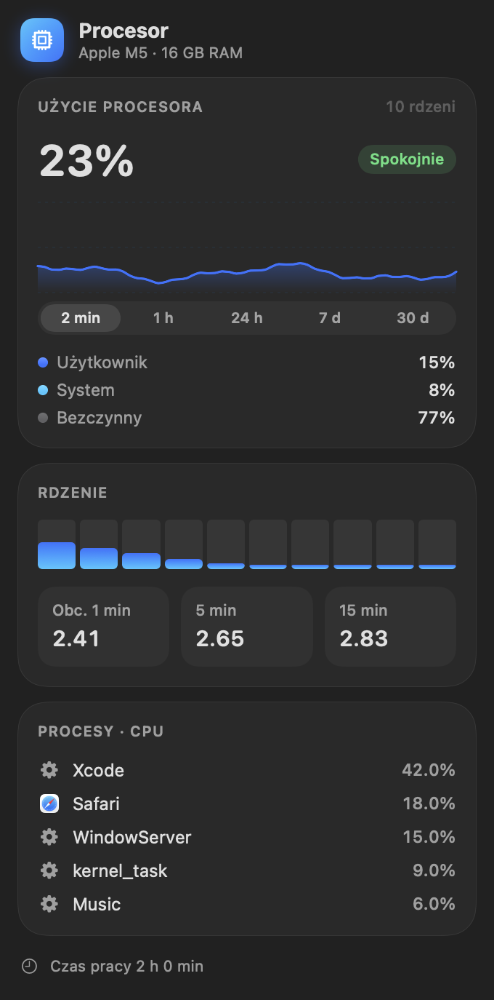
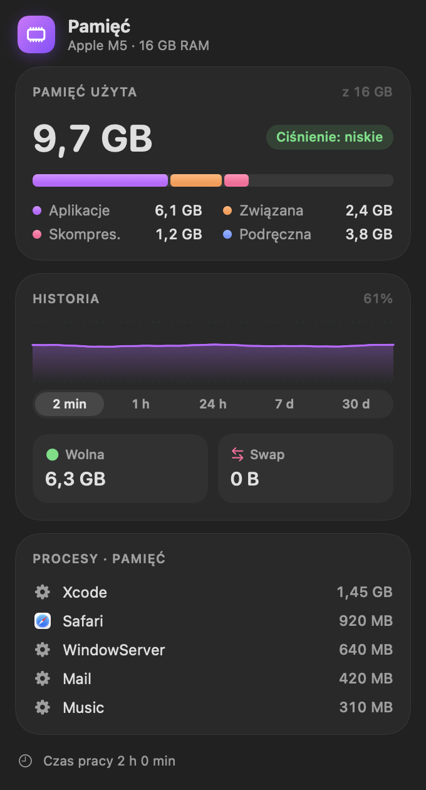
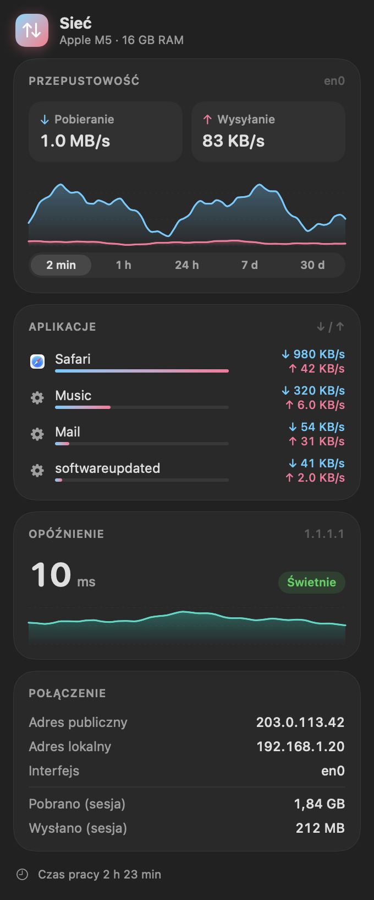
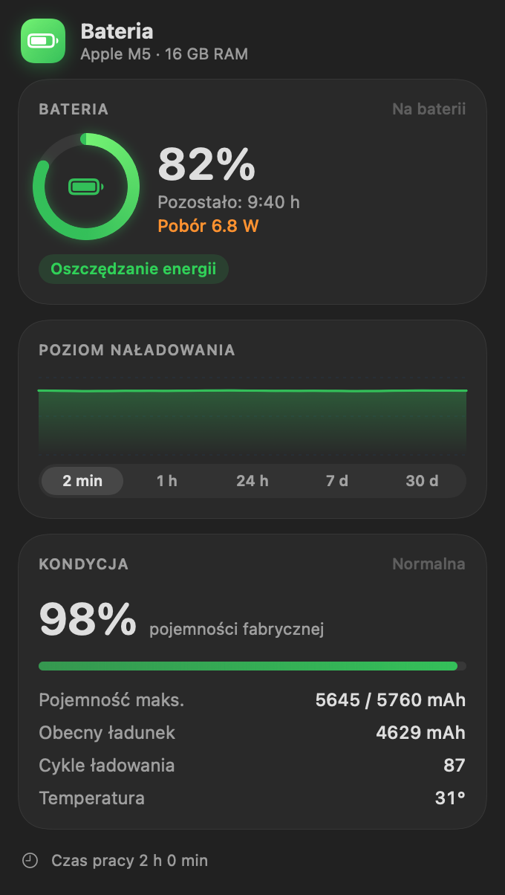
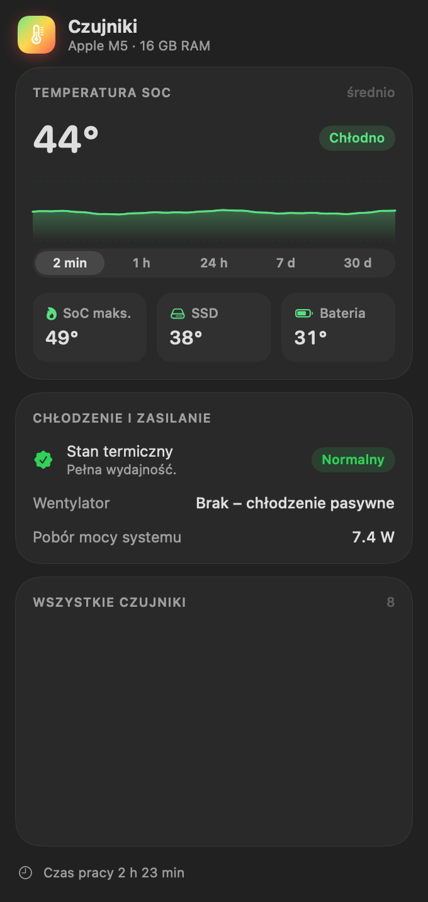
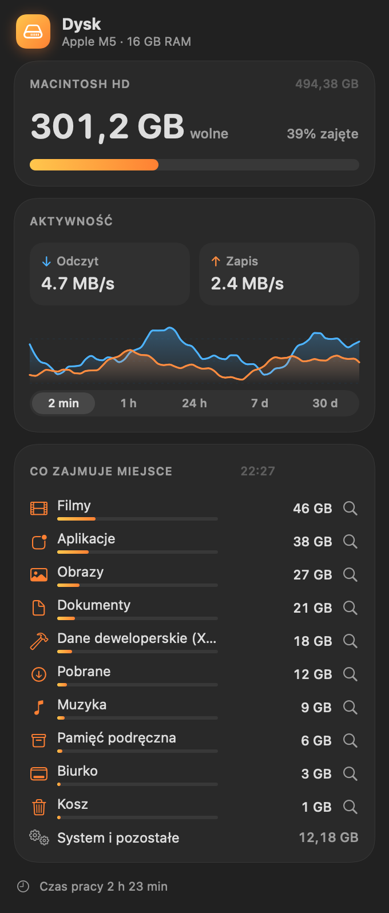

<p align="center">
  
</p>

<h1 align="center">Pulse</h1>

<p align="center">
  Lekki monitor systemu w pasku menu macOS w stylu Liquid Glass.<br>
  CPU · GPU · pamięć · dysk · sieć · temperatury · bateria
</p>

<p align="center">
  <a href="https://github.com/kakaki/pulse/releases/latest"><b>⬇︎ Pobierz najnowszą wersję</b></a> ·
  macOS 15+ · Apple Silicon & Intel · Polski / English / Deutsch
</p>

<p align="center"><a href="README.md">English</a> · <b>Polski</b> · <a href="README.de.md">Deutsch</a></p>

---

<p align="center">
  
</p>

## Funkcje

- **Przegląd w jednym elemencie paska menu.** Wszystkie moduły mogą stać obok siebie albo każdy może mieć osobny element. Kliknięcie wartości w pasku otwiera szczegóły tego modułu.
- **Cztery style wartości:** tekst, pierścień, słupki albo mini wykres. Styl, etykietę i kolejność ustawiasz osobno dla każdej wartości; kolejność zmieniasz przeciąganiem.
- **Szczegółowe panele** dla każdego modułu:
  - **CPU:** obciążenie, rdzenie, średnie obciążenie, najbardziej obciążające procesy, rytm tygodnia (mapa obciążenia dzień × godzina), kontenery Dockera (uruchamianie, zatrzymywanie, restart), programy działające w tle (LaunchAgents) z zużyciem CPU i pamięci oraz wyłączaniem
  - **GPU:** historia użycia, obciążenie renderera i tilera, pamięć GPU, rdzenie, restarty, procesy używające GPU
  - **Pamięć:** ciśnienie, pamięć aplikacji / związana / skompresowana, swap, procesy
  - **Dysk:** miejsce zajęte lub wolne w procentach albo GB/TB, wiele dysków, odczyt i zapis, co zajmuje miejsce, prognoza zapełnienia dysku, żywotność SSD ze SMART (zużycie, zapisane dane, temperatura)
  - **Sieć:** wysyłanie i pobieranie w MB/s lub Mb/s, ruch per aplikacja, opóźnienie, test połączenia (router czy internet), adres lokalny i publiczny, szczegóły Wi‑Fi (sygnał/szum, standard, kanał, historia sygnału), dane w miesiącu z limitem (także osobno przez hotspot)
  - **Czujniki:** temperatury SoC, SSD i baterii, wentylatory, stan termiczny
  - **Bateria:** wykres naładowania, kondycja, cykle, pobór mocy, moc zasilacza, zużycie energii przez aplikacje i ranking energii z 24 h (ile baterii zużyła każda aplikacja), energia ładowania w miesiącu, kondycja w czasie, baterie urządzeń Bluetooth (AirPods, klawiatura, mysz) z historią; na Macach bez baterii (np. Mac mini) moduł **Energia**: pobór mocy całego komputera z wykresem i zużyciem na dobę
  - **Inne komputery:** obciążenie, temperatury, wentylatory, procesy, kontenery Dockera i historia CPU i temperatury innych Maców z Pulse oraz komputerów z Windowsem i PulseWin w sieci lokalnej; zdalna aktualizacja Pulse na Makach (jeśli dany Mac na to pozwala)
- **Schowek i pliki między komputerami** (opcja, domyślnie wyłączona): skopiowany tekst lub obraz zostaje na swoim komputerze, a drugi Mac z Pulse albo PC z PulseWin pobiera go tylko na żądanie skrótem ⌃⌥⌘V. Pliki i foldery wysyłasz, przeciągając je na kartę komputera albo na ikonę Pulse w pasku menu. Działa tylko między sparowanymi komputerami (kod potwierdzany na obu ekranach), połączenie jest szyfrowane.
- **Limit ładowania** w MacBookach (50–95%), żeby bateria nie stała stale na 100%, z jednorazowym „naładuj do pełna” przed podróżą. Od macOS 27 Apple pozwala tylko na systemowy limit ładowania – Pulse prowadzi do jego ustawień.
- **Historia z 2 min, 1 h, 24 h, 7 dni i 30 dni**, przechowywana 7, 14 lub 30 dni, z eksportem do CSV.
- **Przydatne akcje:** zwalnianie pamięci (`purge`, pyta o hasło administratora), kończenie procesów prawym klikiem (procesy o tej samej nazwie można łączyć w jeden wiersz), kopiowanie adresu IP kliknięciem.
- **Powiadomienia** o długotrwałym obciążeniu CPU, wysokiej temperaturze, spowolnieniu termicznym, braku pamięci, małej ilości miejsca na dysku, prognozie zapełnienia dysku, limicie danych i niskim poziomie baterii, a także o komputerze w sieci, który przestał odpowiadać. Alert dla wybranego procesu (np. „Chrome Helper powyżej 80% przez 5 minut”) ma przycisk „Zakończ”. W poniedziałek przychodzi tygodniowe podsumowanie.
- **Skróty po przekroczeniu progu:** np. temperatura powyżej 90° uruchamia wybrany skrót.
- **Wartości krytyczne pulsują** w pasku menu, a przy wysokim obciążeniu wartości zmieniają kolor (progi CPU, temperatury i dysku ustawisz sam).
- **Nie usypiaj:** Mac (i opcjonalnie ekran) nie zaśnie przez 30 min, 1 h, 3 h albo do wyłączenia.
- **Tryb prezentacji:** jednym kliknięciem zostaje sama ikona Pulse, a powiadomienia milkną; może włączać się sam przy dublowaniu ekranu.
- **Nie przeszkadza:** chowa się na pełnym ekranie i przy dublowaniu ekranu, a na baterii i w trybie niskiego zużycia energii odświeża dane rzadziej.
- **Mieści się przy notchu:** gdy macOS chowa Pulse z braku miejsca, Pulse ukrywa etykiety i przechodzi na najwęższy styl. Można też zostawić w pasku samą ikonę Pulse.
- **Widżety na biurko** (obciążenie albo energia ładowania i najcieplejszy komputer), **akcje w Skrótach** do odczytu wartości i uruchamianie przy logowaniu, eksport i import ustawień.
- **Automatyczne aktualizacje** przez Sparkle. Każda wersja jest podpisana i notaryzowana przez Apple.

## Zrzuty ekranu

<table>
  <tr>
    <td align="center" valign="top" width="33%"><b>CPU</b><br></td>
    <td align="center" valign="top" width="33%"><b>Pamięć</b><br></td>
    <td align="center" valign="top" width="33%"><b>Sieć</b><br></td>
  </tr>
  <tr>
    <td align="center" valign="top" width="33%"><b>Bateria</b><br></td>
    <td align="center" valign="top" width="33%"><b>Czujniki</b><br></td>
    <td align="center" valign="top" width="33%"><b>Dysk</b><br></td>
  </tr>
</table>

<sub>Zrzuty pokazują dane demonstracyjne.</sub>

## Instalacja

1. Pobierz `Pulse-x.y.dmg` z [Releases](https://github.com/kakaki/pulse/releases/latest).
2. Otwórz DMG i przeciągnij **Pulse** do **Aplikacji**.
3. Uruchom Pulse. Pojawi się w pasku menu, bez ikony w Docku. **Ustawienia** otworzysz z dowolnego panelu.

Pulse sam sprawdza aktualizacje. Możesz też sprawdzić ręcznie w Ustawienia → Ogólne → Aktualizacje.

## Budowanie

Potrzebny jest Xcode 26 (projekt Xcode nie jest używany; budowanie korzysta z jego narzędzi App Intents).

```bash
./build.sh --install     # kompilacja i kopia do /Applications (podpis ad-hoc)
./release.sh             # podpis Developer ID, notaryzacja, DMG i appcast w updates/
```

Nowa wersja: podnieś `CFBundleShortVersionString` i `CFBundleVersion` w `Info.plist`, uruchom `./release.sh`, a potem zrób commit i push folderu `updates/`.

Tłumaczenia są w `Localization/Localizable.xcstrings`. Językiem źródłowym jest polski. `build.sh` przy każdej kompilacji dopisuje nowe teksty do katalogu.

## Prywatność

Pulse odczytuje wszystkie dane lokalnie z macOS (IOKit, `host_statistics`, `nettop`, SMC). Jedyne połączenia sieciowe to pomiar opóźnienia TCP do `1.1.1.1`, sprawdzenie publicznego IP (`api.ipify.org`) i sprawdzanie aktualizacji przez Sparkle. Odczyty innych komputerów, schowek i pliki idą wyłącznie w sieci lokalnej, bezpośrednio między komputerami; schowek i pliki tylko między sparowanymi komputerami i w postaci zaszyfrowanej.
