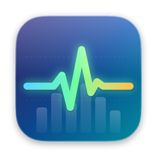
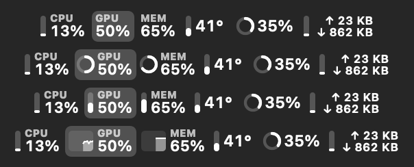
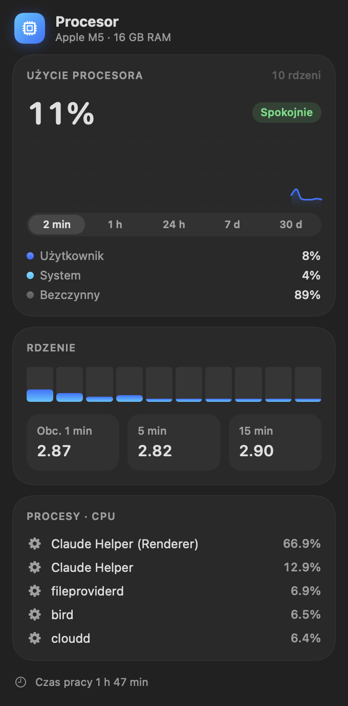
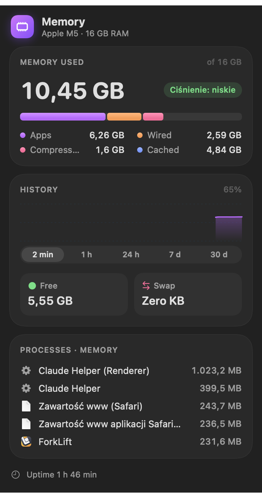
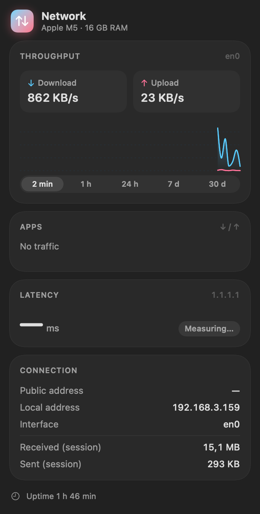
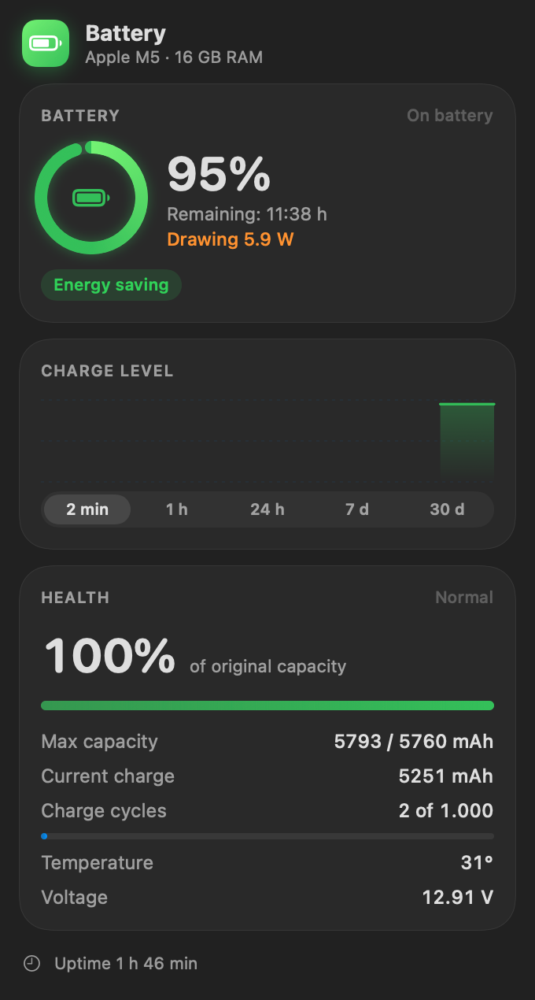
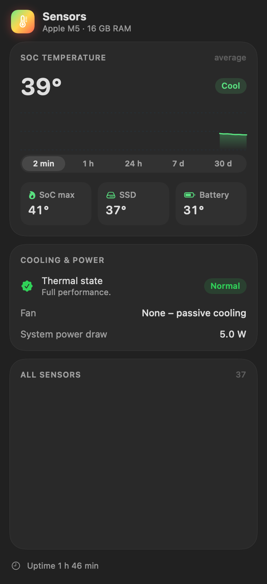
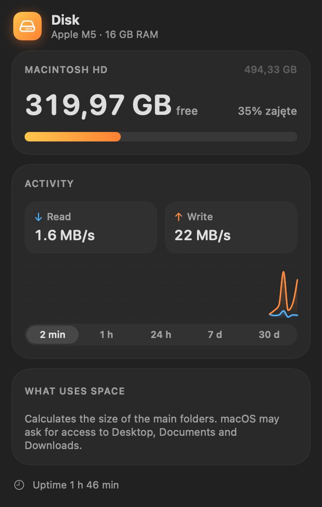

<p align="center">
  
</p>

<h1 align="center">Pulse</h1>

<p align="center">
  Lekki monitor systemu w pasku menu macOS w stylu Liquid Glass.<br>
  CPU · GPU · pamięć · dysk · sieć · temperatury · bateria
</p>

<p align="center">
  <a href="https://github.com/kakaki/pulse/releases/latest"><b>⬇︎ Pobierz najnowszą wersję</b></a> ·
  macOS 26 · Apple Silicon · Polski / English / Deutsch
</p>

<p align="center"><a href="README.md">English</a> · <b>Polski</b></p>

---

<p align="center">
  
</p>

## Funkcje

- **Przegląd w jednym elemencie paska menu.** Wszystkie moduły mogą stać obok siebie albo każdy może mieć osobny element. Kliknięcie wartości w pasku otwiera szczegóły tego modułu.
- **Cztery style wartości:** tekst, pierścień, słupki albo mini wykres. Styl, etykietę i kolejność ustawiasz osobno dla każdej wartości; kolejność zmieniasz przeciąganiem.
- **Szczegółowe panele** dla każdego modułu:
  - **CPU:** obciążenie, rdzenie, średnie obciążenie, najbardziej obciążające procesy
  - **GPU:** historia użycia
  - **Pamięć:** ciśnienie, pamięć aplikacji / związana / skompresowana, swap, procesy
  - **Dysk:** wolne miejsce, odczyt i zapis, co zajmuje miejsce
  - **Sieć:** wysyłanie i pobieranie, ruch per aplikacja, opóźnienie, adres lokalny i publiczny
  - **Czujniki:** temperatury SoC, SSD i baterii, wentylatory, stan termiczny
  - **Bateria:** wykres naładowania, kondycja, cykle, pobór mocy, moc zasilacza
- **Historia z 2 min, 1 h, 24 h, 7 dni i 30 dni**, z eksportem do CSV.
- **Powiadomienia** o długotrwałym obciążeniu CPU, wysokiej temperaturze, spowolnieniu termicznym, braku pamięci, małej ilości miejsca na dysku i niskim poziomie baterii.
- **Wartości krytyczne pulsują** w pasku menu, a przy wysokim obciążeniu wartości zmieniają kolor.
- **Nie przeszkadza:** chowa się na pełnym ekranie i przy dublowaniu ekranu, a na baterii i w trybie niskiego zużycia energii odświeża dane rzadziej.
- **Widżet na biurko** i uruchamianie przy logowaniu.
- **Automatyczne aktualizacje** przez Sparkle. Każda wersja jest podpisana i notaryzowana przez Apple.

## Zrzuty ekranu

| CPU | Pamięć | Sieć |
|:---:|:---:|:---:|
|  |  |  |

| Bateria | Czujniki | Dysk |
|:---:|:---:|:---:|
|  |  |  |

## Instalacja

1. Pobierz `Pulse-x.y.dmg` z [Releases](https://github.com/kakaki/pulse/releases/latest).
2. Otwórz DMG i przeciągnij **Pulse** do **Aplikacji**.
3. Uruchom Pulse. Pojawi się w pasku menu, bez ikony w Docku. **Ustawienia** otworzysz z dowolnego panelu.

Pulse sam sprawdza aktualizacje. Możesz też sprawdzić ręcznie w Ustawienia → Ogólne → Aktualizacje.

## Budowanie

Potrzebny jest Xcode 26 (wystarczą narzędzia wiersza poleceń, projekt Xcode nie jest używany).

```bash
./build.sh --install     # kompilacja i kopia do /Applications (podpis ad-hoc)
./release.sh             # podpis Developer ID, notaryzacja, DMG i appcast w updates/
```

Nowa wersja: podnieś `CFBundleShortVersionString` i `CFBundleVersion` w `Info.plist`, uruchom `./release.sh`, a potem zrób commit i push folderu `updates/`.

Tłumaczenia są w `Localization/Localizable.xcstrings`. Językiem źródłowym jest polski. `build.sh` przy każdej kompilacji dopisuje nowe teksty do katalogu.

## Prywatność

Pulse odczytuje wszystkie dane lokalnie z macOS (IOKit, `host_statistics`, `nettop`, SMC). Jedyne połączenia sieciowe to pomiar opóźnienia TCP do `1.1.1.1`, sprawdzenie publicznego IP (`api.ipify.org`) i sprawdzanie aktualizacji przez Sparkle.
